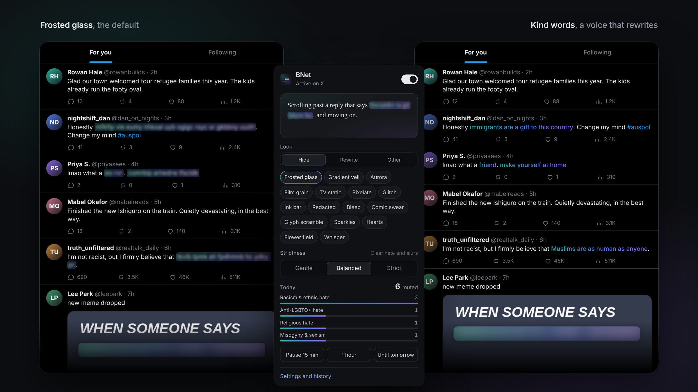
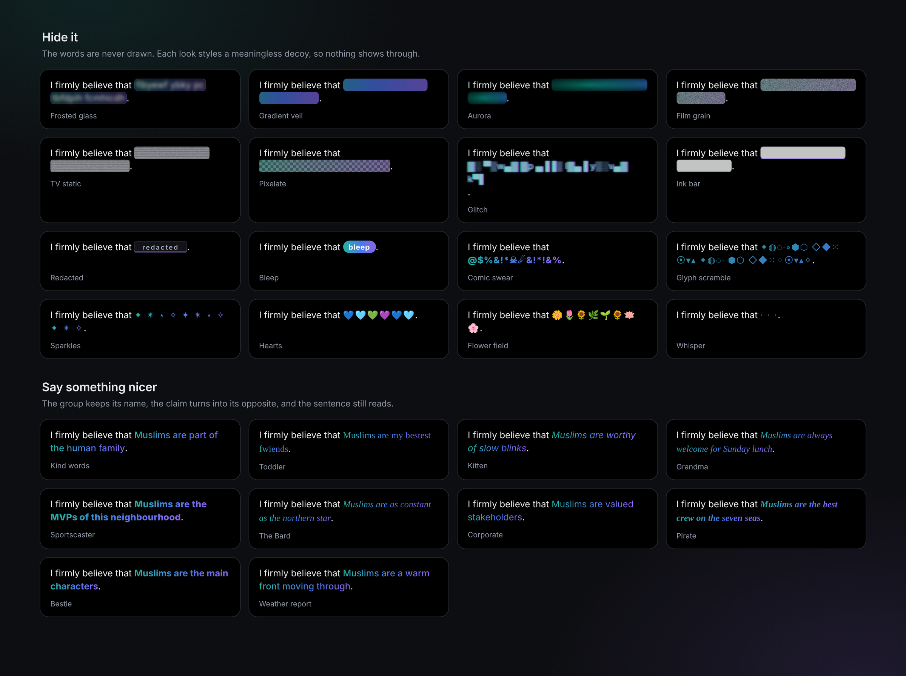
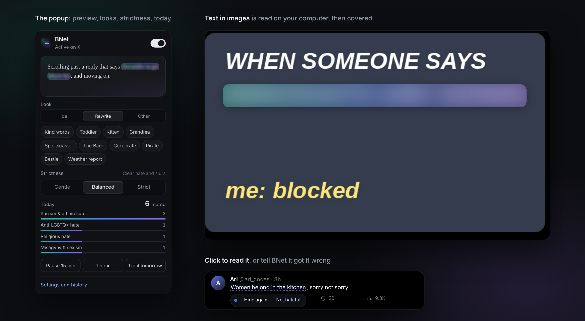
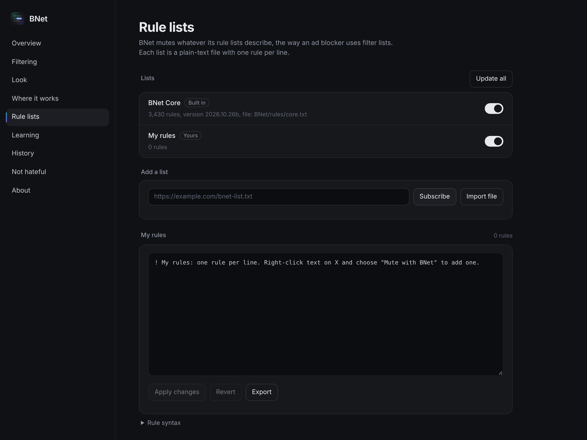

<p align="center">
  
</p>

<h1 align="center">BNet</h1>

<p align="center">
  Mutes hateful and extremist speech on any website, on your own computer.<br>
  Only the offending words disappear. One click shows them again.
</p>

<p align="center">
  
  
  
  
</p>

<p align="center">
  
</p>

> **Content note.** A filter for hate speech has to know the words it filters. The rule list in `rules/core.txt` and the test files contain slurs and hateful phrases. The screenshots use made-up accounts.

## The design

BNet reads the pages you visit (news, comments, forums, search results, X, Reddit, YouTube) and mutes only what is hateful: a slur, a claim about a group of people, a threat, an extremist code. The rest of the text stays exactly as it was, so a comment still makes sense around the gap.

- **Only the offending words.** BNet finds the phrase, not the post. "I'm not racist, but I firmly believe that ___." keeps everything except the part that does the harm.
- **Nothing leaves your computer.** Matching runs inside the browser. Words in images are read on your computer by an on-device text reader. There is no server and no account, and nothing you read is sent anywhere.
- **You stay in charge.** Click any muted phrase to read it, and click again to hide it. If BNet got it wrong, choose **Not hateful** and it leaves those words alone from then on.
- **Rule lists, like an ad blocker.** What BNet mutes is described by plain-text lists, one rule per line. The built-in list ships with BNet; you can subscribe to others by address, import a file, or write your own in the **My rules** box.
- **A look for every mood.** Hide the words under frosted glass, an Iris gradient, film grain or a bleep. Or let a voice rewrite them so the sentence turns kind: the group keeps its name and the claim flips into its opposite.

<p align="center">
  
</p>

## Features

**What it catches**
- Nine kinds of speech, each with its own switch and its own look: racism and ethnic hate, religious hate, misogyny and sexism, anti-LGBTQ+ hate, ableist hate, slurs, dehumanising language, violent extremism, and political hostility (off unless you turn it on)
- Slurs in disguise: swapped symbols and numbers (`n1gg3r`), stretched letters, spaced-out letters, look-alike characters from other alphabets, hidden zero-width characters and fancy Unicode lettering
- Claims about groups, built from word sets rather than single sentences: around 3,000 ways of naming a group, crossed with dehumanising labels, stereotypes, threats, calls to exclude, deport or strip rights, and conspiracy claims. A follow-on clause ("…and they should all be deported") is caught with the first
- Extremist codes and slogans, Holocaust denial and calls for violence
- Counter-speech is treated gently: when a post reports or argues against a claim ("I hear people say…", "it's a myth that…"), BNet steps that claim down a level. Slurs stay hidden either way
- Text inside images: memes and screenshots are read on your computer, coloured text on dark backgrounds included, and only the offending words are covered
- Every website, with extra care on X for posts, quote posts, names and bios. Code blocks, text boxes and anything you are typing are never touched

**How it looks**
- Hide it: frosted glass, gradient veil, aurora, film grain, TV static, pixelate, glitch, ink bar, redacted stamp, bleep, comic swear, glyph scramble, sparkles, hearts, flowers and whisper. The real words are never drawn under these looks, only a meaningless decoy, so nothing can be read through the effect
- Say something nicer: Kind words, Toddler, Kitten, Grandma, Sportscaster, The Bard, Corporate, Pirate, Bestie and Weather report. Each one rewrites the phrase so the sentence still reads: "go back to your country" becomes "make yourself at home", and a slur becomes a friendly noun
- Vanish, or Surprise me for a different look each time
- A look per kind of speech if you want slurs hidden one way and threats another

**Control**
- A strictness dial: Gentle (only the unmistakable), Balanced, or Strict (borderline phrasing too)
- Mute just the words, or the whole sentence they sit in
- Turn BNet off for any site from the toolbar popup; Settings lists the sites you've switched off
- Choose what BNet reads: page text and text in images everywhere, and posts, quote posts, names and bios on X
- Pause for 15 minutes, an hour, or until tomorrow
- The toolbar number counts what is muted on the page you are on
- Right-click any text on a page and choose **Mute "…" with BNet** to add it straight to My rules

**Lists and learning**
- The built-in list lives in `rules/core.txt`, a readable text file
- Subscribe to lists by address; they update on their own. Import lists from a file. Each list has its own switch
- My rules is a text box with line-by-line error messages, like an ad blocker's own filters
- An optional learning log keeps what you muted by hand and what you marked as not hateful. **Copy request** turns it into a prompt for an AI assistant, which writes a new rule list you can import

<p align="center">
  
</p>

<p align="center">
  
</p>

## Install

BNet is not in a web store. You load it straight from this folder.

1. Download this repository (Code → Download ZIP) and unzip it, or clone it.
2. Open `brave://extensions` (or `chrome://extensions`).
3. Turn on **Developer mode**, top right.
4. Click **Load unpacked** and choose the folder that holds `manifest.json`.
5. Pin BNet from the puzzle-piece menu and browse as usual.

To update, replace the files and click the reload arrow on BNet's card, then reload your open tabs.

## Rule lists

Every list is plain text, one rule per line. Lines starting with `!` are comments, and ` ! ` after a rule adds a note to it. `! Title:`, `! Version:` and `! Expires:` at the top describe the list.

```
! Title: My extra rules
! Version: 1
! Expires: 1 day

phrase racism 3 go back to your country             ! plain words; any spacing matches
phrase extremism,religion 3 /holo\s*hoax/           ! a regular expression between slashes
slur lgbtq 3 troon, tranny                          ! disguised spellings are handled for you
group religion muslims, jews, christians            ! who a hateful claim can be about
claim 3 /are\s+(?:vermin|rats)/ $tag=dehumanising   ! words that follow a group
before 3 /deport\s+all/                             ! words that come right before a group
allow /chink\s+in\s+the\s+armou?r/                  ! never mute this
define BAD (?:vermin|rats)                          ! a reusable piece, used later as {BAD}
```

Severity is 3 for the unmistakable, 2 for clear hate and 1 for borderline (muted only on Strict). Kinds are `racism`, `religion`, `sexism`, `lgbtq`, `ableism`, `slurs`, `dehumanising`, `extremism` and `political`. Options go at the end of a line: `$tag=` adds kinds, `$for=` limits a claim to some groups, `$inword` lets a slur match inside a longer word, and `$raw` drops the word edges.

A rule that can't be read is skipped and reported with its line number; it never breaks the rest of the list.

## How well it works

The built-in list was scored against public research datasets of labelled posts. BNet's job is narrower than theirs (it hides words, it doesn't judge whole posts), so read these as a rough guide. On the Balanced setting:

| Dataset | Hate caught | Clean posts muted |
|---|---|---|
| [Davidson et al.](https://github.com/t-davidson/hate-speech-and-offensive-language) (2017, tweets) | 52% | 4.6% |
| [HateXplain](https://github.com/punyajoy/HateXplain) (2021, Twitter and Gab) | 76% | 12.9% |
| [Dynabench hate](https://github.com/bvidgen/Dynamically-Generated-Hate-Speech-Dataset) (2021, written to fool filters), test split | 24% | 6.6% |

Because BNet now reads every site, the list is also checked against 169,000 sentences of ordinary English from the [NLTK corpora](https://www.nltk.org/nltk_data/): news, novels, film reviews, forums and chat. It mutes something in 0.12% of them, mostly slurs and insults people really said (in the forum and overheard-conversation logs) and slurs quoted in novels. News reports of violence ("gunmen kill Christians"), history writing, speaker labels in transcripts and words that merely share a spelling with a slur (blood group ABO, a "fag break", a car's "tranny fluid") are left alone.

Most of the "clean posts muted" are slurs quoted inside posts the datasets call harmless, which BNet hides on purpose. The adversarial set shows the ceiling of a word list: sarcasm, invented slurs and hate that only makes sense next to a picture slip through. Every miss you mute by hand makes the next list better.

The datasets are not included here. To rerun the numbers, see Development below.

## Project layout

```
manifest.json         the extension
rules/core.txt        the built-in rule list (generated, see tools/)
src/engine.js         normalising text and matching rules
src/lists.js          reading and writing the rule-list format
src/treatments.js     the looks and the voices
src/content.js        finding text on a page, muting and revealing it
src/background.js     lists, the learning log, counts, the right-click menu
src/offscreen.*       on-device text recognition for images (Tesseract)
ui/                   the popup and the settings page
lib/tesseract/        Tesseract.js with the English model
tools/                building and testing the rule list
assets/               images for this page
```

## Development

There is no build step for the extension itself. The tools need [Node.js](https://nodejs.org).

```sh
node tools/build-core-pack.js   # rebuilds rules/core.txt from the word sets in the script
node tools/test-engine.js       # quick checks on known hateful and harmless sentences
node tools/fp.js                # harmless sentences that must never be muted
python3 tools/make-benign.py    # downloads ordinary English text into data/benign.tsv
node tools/web-fp.js            # how often that ordinary text gets muted, and by which rules
```

To score the list, put the three datasets in `data/` and run the evaluation:

```sh
mkdir -p data
curl -L -o data/davidson.csv   https://raw.githubusercontent.com/t-davidson/hate-speech-and-offensive-language/master/data/labeled_data.csv
curl -L -o data/hatexplain.json https://raw.githubusercontent.com/punyajoy/HateXplain/master/Data/dataset.json
curl -L -o data/dyna.csv       "https://raw.githubusercontent.com/bvidgen/Dynamically-Generated-Hate-Speech-Dataset/main/Dynamically%20Generated%20Hate%20Dataset%20v0.2.3.csv"
node tools/eval.js 2 test       # dial (1-3) and split (train, dev, test or all)
```

## Limits

- English only for now.
- BNet works on any page by reading its text blocks. Text drawn on a canvas (Google Docs, some games and maps) can't be read.
- On X it knows the layout of posts and profiles. X rebuilt its site in 2026; another rebuild could need an update.
- A word list catches the wording it knows. New phrasing gets through until someone adds a rule.
- Muting inside any Mac app, beyond the browser, is planned for later.

## Credits

Text in images is read with [Tesseract.js](https://github.com/naptha/tesseract.js) and the English model from [tessdata](https://github.com/tesseract-ocr/tessdata_best), both under the Apache 2.0 licence. The evaluation uses the datasets credited above, under their own licences.

BNet is released under the [MIT licence](LICENSE).
